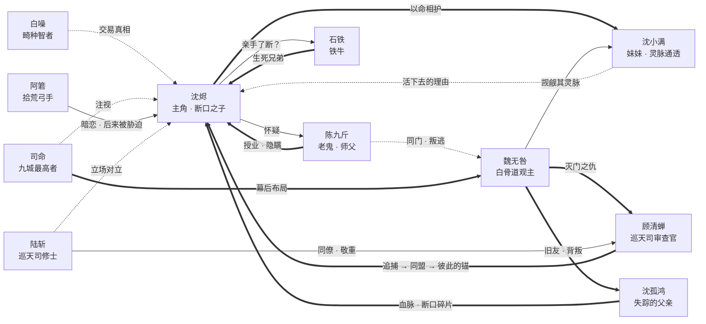

# 《天裂纪》· 人物关系

---

## 一 · 人物关系总图



---

## 二 · 人物卡片

### 【主角】沈烬｜17 岁｜拾荒人

> "我不怕变成怪物。我怕的是变成怪物以后，还觉得自己没错。"

| 项目 | 内容 |
|---|---|
| 外貌 | 瘦，左眼下方有旧疤，常年一件洗得发白的拾荒斗篷。蚀纹极淡——这是他的秘密 |
| 出身 | 孤星城贫民区，父亲十年前失踪，母亲死于尸潮 |
| 性格 | 沉默、算得清、护短。对陌生人冷，对认定的人不要命 |
| 金手指 | **体内嵌着一小片断口碎片**：能吞噬蚀气转化为修为，代价是身体局部短暂异化成"不属于人的东西" |
| 欲望 | 让妹妹活到成年 |
| 恐惧 | 自己异化后，会亲手伤害妹妹 |
| 弧光 | 从"守住人形"→"接受异化"→"自己决定异化成什么" |
| 口头禅 | "先活下去，再谈别的。" |

**写作要点**：他的强大必须始终伴随**身体代价**。每次用碎片，都要写清楚"这次坏的是哪里"——手指、眼角、影子、声音。读者要能数出他失去了什么。

---

### 【核心】沈小满｜11 岁｜沈烬的妹妹

> "哥，你手怎么这么凉？"

| 项目 | 内容 |
|---|---|
| 特征 | 天生**灵脉通透**——在上层眼里是顶级"灵材"，在医馆眼里是绝症 |
| 病症 | 灵脉会自动吸纳蚀气，蚀值涨得比常人快三倍 |
| 功能 | 主角所有行动的**动机源**，也是全书最大的软肋 |
| 秘密 | 灵脉不是天生的，是**被人"种"进去的**（卷二末揭示） |
| 命运 | 是魏无咎"羽化"计划的钥匙，也是终章主角抉择的砝码 |

**写作要点**：不要把她写成纯粹的拖油瓶。让她有自己的判断、自己的隐瞒，甚至在某一卷里做出让主角意外的选择。

---

### 【师父】陈九斤｜61 岁｜拾荒人首领 / 前白骨道丹师

> "小子，人这一辈子，能不吃的东西就别吃。可要是快饿死了——那就别客气。"

| 项目 | 内容 |
|---|---|
| 外貌 | 瘸左腿，独眼，满口黄牙，随身一口黑锅 |
| 表面身份 | 孤星城拾荒人的头儿，黑市活地图 |
| 真实身份 | 白骨道"丹房"叛逃者，手上人命不比魏无咎少 |
| 与主角 | 收徒、授业、利用，三者同时进行，他自己也分不清哪个更多 |
| 秘密 | 瘸腿是自己打断的——为了让白骨道以为他废了 |
| 结局 | 卷二末为掩护主角而死，临终只说出"沈孤鸿"三个字 |

**写作要点**：他是主角的"黑暗导师"，教的第一课不是功法，是**"怎么吃人"**。他必须在读者最依赖他的时候死掉。

---

### 【女主】顾清蝉｜24 岁｜巡天司审查官

> "我不是在抓你。我是在你身上，看我还有没有救。"

| 项目 | 内容 |
|---|---|
| 外貌 | 高挑，永远一身赤霄城制式黑甲，戴半张面甲，手套从不摘下 |
| 身份 | 巡天司最年轻的"审查官"，专司清污与异化者处置 |
| 能力 | 三境开脉，剑术极冷，判断力近乎无情 |
| 秘密 | **蚀值 63%**，已过崩线。靠"蝉衣"（名字的由来）维持人形。她是白骨道实验体的逃出者 |
| 与主角 | 追捕 → 交易 → 同盟 → 彼此唯一能"看见人形"的人 |
| 与魏无咎 | 血仇。魏无咎是她的"造物主" |
| 恐惧 | 被人看见手套下的手 |

**写作要点**：她是主角的**镜像**——已经异化、却还在假装做人。两人关系的核心不是爱情，是**"你替我证明人还能做人"**。

---

### 【反派】魏无咎｜43 岁｜白骨道观主之一

> "你们把这叫异化。我把它叫长大。"

| 项目 | 内容 |
|---|---|
| 外貌 | 温和、干净、爱穿白衣，说话很轻，从不提高音量 |
| 立场 | 认为"人"只是羽化前的幼虫形态，异化是进化 |
| 与沈孤鸿 | 少年挚友，同入第七勘队，后因断口之下的发现分道扬镳 |
| 对沈烬 | 高度兴趣——沈烬是唯一"没被蚀吃掉"的样本 |
| 对小满 | 觊觎灵脉，视为羽化的钥匙 |
| 恐怖之处 | 他所有的恶，都出于**真诚的爱**——他真的相信自己在救人类 |
| 弱点 | 他无法接受"有人宁愿做人" |

**写作要点**：反派的说服力要强到让读者动摇。他每一次出场，都应该让主角（和读者）多一分认同。

---

### 【父亲】沈孤鸿｜失踪 10 年｜第七勘队队长

> （全书只以遗物、录音、他人回忆出现）

| 项目 | 内容 |
|---|---|
| 身份 | 九城最顶尖的勘队队长，深入坠灵带次数最多的人 |
| 真相 | 他是第一个抵达断口正下方并活着回来的人。他看见了"第八境"，然后选择封口 |
| 与主角 | 沈烬体内的断口碎片，是他亲手植入的 |
| 与老鬼 | 老鬼的叛逃，是他安排的 |
| 下落 | 下落不明。有三种可能（写作时可择一，或全部保留）：① 被联盟秘密关押；② 已成为断口的一部分；③ 他就是"司命" |

**写作要点**：他是全书最大的**信息黑箱**。每次揭示只给一块拼图，绝不给全貌。

---

### 【兄弟】石铁（铁牛）｜20 岁｜拾荒人

> "烬哥，你说人要是变成那样了，还算人不？"

| 项目 | 内容 |
|---|---|
| 外貌 | 两米高，憨，笑起来缺颗牙 |
| 定位 | 主角在荒原上唯一的"正常人"参照。他代表"普通人" |
| 转折 | 卷二末为救主角，主动吞下高阶灵核，蚀值飙升 |
| 结局 | 卷三异化。主角必须在他彻底变成畸种前做出选择 |
| 作用 | 全书**伦理试炼**：主角的"底线"到底在哪 |

---

### 【情报源】白噪｜年龄不明｜高阶畸种

> "你父亲让我等你。……他等了很久，等得不耐烦了。"

| 项目 | 内容 |
|---|---|
| 形态 | 一团会说话的、由无数张人脸组成的"雾"。声音像收音机调频 |
| 身份 | 蚀值 100 却保留人格的异类，唯一案例 |
| 功能 | 提供真相碎片、制造诡异氛围、偶尔是唯一的救兵 |
| 动机 | 不明。它似乎在"收集"人的选择，看人到底能坚持到哪一步 |
| 名言 | "我不是怪物。我只是很久没人叫我的名字了。" |

---

### 【幕后】司命｜年龄不明｜九城联盟最高席位

> （全书不露正脸）

| 项目 | 内容 |
|---|---|
| 设定 | 从不露面，所有指令通过"契"传达。因为"露面"本身就意味着某种不可逆的污染 |
| 猜测 | 疑为第八境的残躯，或断口的"人格化" |
| 作用 | 全书最高层的规则制定者，也是终章最后一个变量 |
| 反转预留 | 若取"沈孤鸿即司命"方案，则终章父子对峙 |

---

### 【配角】阿箬｜19 岁｜拾荒弓手

> "你别老一个人扛。你又不是石头。"

| 项目 | 内容 |
|---|---|
| 定位 | 主角荒原小队的队友，暗恋主角但从不表白 |
| 功能 | 提供"正常的情感"，让主角有软着陆 |
| 转折 | 卷三被白骨道胁迫，成为主角的叛徒（或被误认为叛徒） |
| 作用 | 让读者明白：主角连累的人，不止妹妹一个 |

---

### 【配角】陆斩｜22 岁｜巡天司修士

> "规矩就是规矩。你破了，我抓你；你守了，我敬你。"

| 项目 | 内容 |
|---|---|
| 定位 | 顾清蝉的下属，直率、认死理 |
| 功能 | 体制内的"良心"，也是主角与联盟之间可能的缓冲 |
| 结局方向 | 卷三为掩护主角与顾清蝉而死，或活着成为新秩序的骨干 |

---

## 三 · 关系张力表

| 关系 | 表面 | 内里 | 爆发点 |
|---|---|---|---|
| 沈烬 ↔ 小满 | 兄妹 | 守护者与被守护者的反向控制 | 小满知道自己是"钥匙"后，主动牺牲 |
| 沈烬 ↔ 老鬼 | 师徒 | 温暖与利用并存 | 老鬼死前的那句话 |
| 沈烬 ↔ 顾清蝉 | 逃犯与追捕者 | 两个异化者的互相辨认 | 顾清蝉的面甲第一次被摘下 |
| 沈烬 ↔ 魏无咎 | 猎人与猎物 | 魏无咎真心想"救"他 | 魏无咎提出一个主角无法反驳的理由 |
| 顾清蝉 ↔ 魏无咎 | 仇人 | 她是他的作品，恨里掺着"想被承认" | 她亲手毁掉自己的来源 |
| 老鬼 ↔ 魏无咎 | 叛逃的同门 | 老鬼曾是他的助手 | 老鬼承认：白骨道的丹方有一半是他写的 |
| 沈烬 ↔ 铁牛 | 兄弟 | 主角必须亲手了断 | 铁牛求他动手 |
| 沈烬 ↔ 阿箬 | 队友 | 情感与背叛 | "我不是故意的" |
| 沈孤鸿 ↔ 所有人 | 失踪者 | 他是所有线索的起点与终点 | 三种下落方案揭晓 |
| 司命 ↔ 沈烬 | 注视 | 一场蓄谋十年的培养 | 终章 |

---

## 四 · 阵营站位图

```mermaid
quadrantChart
    title 阵营立场：人性 ←→ 异化 / 秩序 ←→ 自由
    x-axis 秩序 "秩序"
    y-axis 人性 "守人"
    quadrant-1 体制内守序
    quadrant-2 体制内异化
    quadrant-3 荒野异化
    quadrant-4 荒野守序
    "顾清蝉": [0.78, 0.62]
    "陆斩": [0.86, 0.80]
    "司命": [0.92, 0.18]
    "魏无咎": [0.42, 0.10]
    "陈九斤": [0.30, 0.55]
    "沈烬": [0.35, 0.78]
    "沈小满": [0.55, 0.88]
    "石铁": [0.20, 0.70]
    "白噪": [0.10, 0.30]
    "阿箬": [0.22, 0.82]
```

---

## 五 · 人物弧光进度表

| 人物 | 起点 | 中点 | 终点 |
|---|---|---|---|
| 沈烬 | 只想让妹妹活 | 接受自己正在变成怪物 | 主动选择变成什么 |
| 顾清蝉 | 用规则掩盖异化 | 承认自己早已不是人 | 摘下蝉衣，以真身活着或死去 |
| 小满 | 被保护的病人 | 得知自己是"钥匙" | 替哥哥做一次决定 |
| 老鬼 | 混吃等死的老拾荒人 | 身份暴露 | 用死换主角一条命 |
| 铁牛 | 憨厚的兄弟 | 开始异化 | 求死 / 或成为新的"白噪" |
| 魏无咎 | 优雅的救世者 | 计划受阻 | 被自己"爱"出来的东西反噬 |
| 阿箬 | 暗恋的队友 | 被胁迫背叛 | 用命还债 |

---

## 六 · 备用角色池（需要时取用）

- **柳三娘**｜孤星城黑市老板娘，卖消息也卖人，笑起来缺一颗门牙。
- **孙哑**｜铭骨师，不能说话（舌头自己割的），在骨头上刻功法，收费是一段记忆。
- **周观澜**｜青冥城天文学家，最早发现断口在扩张的人，被联盟软禁。
- **七号**｜白骨道实验体编号，顾清蝉的"妹妹"，还活着，但不完整。
- **小满的班主任**｜旧城废墟里一所"学校"的唯一老师，教孩子们念旧世界的诗。

---

## 七 · 写作提醒

1. **每个角色都要有一个"不能碰的东西"**——手套、妹妹、名字、镜子。这是他们人性的锚。
2. **不要让反派解释自己**。让他的行为本身合理到可怕。
3. **异化要具体**：不写"他变得不像人"，写"他今天多长了一根手指，指甲是黑的"。
4. **每次主角变强，都要让某个关系变坏**。力量的代价必须落在人与人之间。
